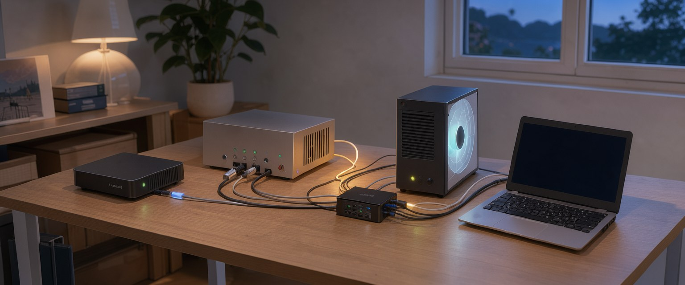

# labwright



Your local AI servers (ComfyUI, Ollama and similar) as one pool an agent can read: which host is up, idle or busy, where a model lives, which host should take a job (or which one to queue behind), and which drive can take a download while keeping a free-space floor.

It only reads. `lw.py` sends HTTP GET requests and runs local read commands (`nvidia-smi` queries, disk usage). It never submits, cancels, unloads, restarts or downloads anything; the agent or another plugin runs the job.

## Install

```
/plugin marketplace add m4bwav/labwright
/plugin install labwright@labwright
```

## Set up the registry

Copy `skills/labwright/hosts.example.json` to `hosts.json` in a private folder, set `LABWRIGHT_HOME` to that folder, and fill in your hosts (roles, services, GPU, model stores, floor). Then:

```
python skills/labwright/scripts/lw.py doctor
```

## Commands

| Command | What it answers |
|---|---|
| `hosts` | the registry, validated |
| `status [--json]` | each host idle, busy or down, with reasons (queue, loaded models, GPU load) |
| `where <model>` | which host has a checkpoint, LoRA or Ollama tag |
| `pick --role R [--model M] [--vram GB] [--batch]` | the idle host (or every idle host for a batch), or which busy host to queue behind |
| `place --size GB [--role R]` | which stores keep the floor after a download |
| `doctor` | status plus drift between the registry and what the probes see |

## Private notes

Your registry and anything that names your machines stay out of the repository. Keep them in the folder `LABWRIGHT_HOME` points to. The leak test reads a `leak-terms.txt` there and fails if any tracked file contains one of those terms; without the folder it skips.

## Tests

`python -m unittest discover -s tests` (no network; a local fake server plays ComfyUI and Ollama). Set `LABWRIGHT_HOME` first so the leak test runs instead of skipping.

## Keeping current

The skill is an evergreen unit: its research on the ComfyUI and Ollama read APIs and `nvidia-smi` is rechecked on a schedule, and `skills/labwright/CHANGELOG.md` records every change with its reason.

## License

MIT
